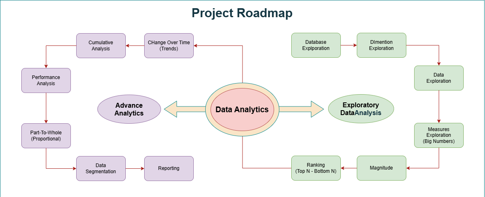

# Data Warehouse Analytics Project

SQL Server analytics project that explores customer, product, and sales data from database initialization through reusable customer and product reporting views.

The project follows a complete analytics workflow:

**Database setup → Exploration → Measures → Advanced analytics → Segmentation → Reporting**



## Project objectives

This project was completed to:

- Build a SQL Server sales-analytics database from flat files.
- Understand the structure and available dimensions of the data.
- Establish business KPIs such as sales, orders, customers, products, quantity, and average price.
- Compare performance by country, gender, category, customer, and product subcategory.
- Analyze sales trends, cumulative performance, and year-over-year changes.
- Measure each product category's contribution to total revenue.
- Segment customers and products into actionable groups.
- Create reusable customer and product reporting views.

## Project structure

```text
Advance Data Analysis/
├── datasets/
│   ├── DataWarehouseAnalytics.bak
│   └── flat-files/
│       ├── dim_customers.csv
│       ├── dim_products.csv
│       └── fact_sales.csv
├── docs/
│   ├── icon_02.png
│   ├── project_roadmap.png
│   ├── project_roadmap_drawio.drawio
│   └── project_roadmap_analysis.md
└── scripts/
    ├── 00_init_database.sql
    ├── 01_database_exploration_01.sql
    ├── 02_explore_dimension.sql
    ├── 03_date_exploration.sql
    ├── 04_measures_exploration.sql
    ├── 05_magnitude.sql
    ├── 06_ranking.sql
    ├── 07_change_over_time_analysis.sql
    ├── 08_cumulative_analysis.sql
    ├── 09_performance_analysis.sql
    ├── 10_part_to_whole_analysis.sql
    ├── 11_data_segmentation.sql
    ├── 12_report_customers.sql
    └── 13_report_products.sql
```

## Data model

The database is named `DataWarehouseAnalytics` and uses the `gold` schema.

### Tables

| Table | Description |
|---|---|
| `gold.dim_customers` | Customer identity, demographic, geography, and date attributes. |
| `gold.dim_products` | Product names, categories, subcategories, costs, and product metadata. |
| `gold.fact_sales` | Sales transactions containing orders, dates, customers, products, sales amounts, quantities, and prices. |

The sales fact table connects to the customer and product dimensions through `customer_key` and `product_key`.

### Reporting views

| View | Description |
|---|---|
| `gold.report_customers` | Customer-level sales behavior, age groups, customer segments, recency, AOV, and monthly spend. |
| `gold.report_products` | Product-level sales performance, product segments, recency, lifespan, revenue, customers, and average metrics. |

## Analysis roadmap

| Stage | Script | Analysis |
|---:|---|---|
| Foundation | [`00_init_database.sql`](scripts/00_init_database.sql) | Creates the database, schema, tables, and loads CSV data. |
| 1 | [`01_database_exploration_01.sql`](scripts/01_database_exploration_01.sql) | Explores table and column metadata. |
| 2 | [`02_explore_dimension.sql`](scripts/02_explore_dimension.sql) | Explores customer countries and product hierarchy. |
| 3 | [`03_date_exploration.sql`](scripts/03_date_exploration.sql) | Finds sales date coverage and customer age boundaries. |
| 4 | [`04_measures_exploration.sql`](scripts/04_measures_exploration.sql) | Calculates core business KPIs. |
| 5 | [`05_magnitude.sql`](scripts/05_magnitude.sql) | Compares customers, products, costs, revenue, and quantity by group. |
| 6 | [`06_ranking.sql`](scripts/06_ranking.sql) | Identifies top and bottom product subcategories by revenue. |
| 7 | [`07_change_over_time_analysis.sql`](scripts/07_change_over_time_analysis.sql) | Analyzes monthly and yearly sales trends. |
| 8 | [`08_cumulative_analysis.sql`](scripts/08_cumulative_analysis.sql) | Calculates running totals and moving average price. |
| 9 | [`09_performance_analysis.sql`](scripts/09_performance_analysis.sql) | Compares product performance with averages and prior years. |
| 10 | [`10_part_to_whole_analysis.sql`](scripts/10_part_to_whole_analysis.sql) | Measures category contribution to total sales. |
| 11 | [`11_data_segmentation.sql`](scripts/11_data_segmentation.sql) | Segments products by cost and customers by value and lifespan. |
| 12 | [`12_report_customers.sql`](scripts/12_report_customers.sql) | Creates the reusable customer report view. |
| 13 | [`13_report_products.sql`](scripts/13_report_products.sql) | Creates the reusable product report view. |

For the complete explanation of what was done and why each analysis was performed, see [`project_roadmap_analysis.md`](docs/project_roadmap_analysis.md).

## How to run

### Requirements

- Microsoft SQL Server.
- SQL Server Management Studio (SSMS) or another SQL Server client.
- Permission to create and drop the `DataWarehouseAnalytics` database.
- Permission for SQL Server to read the CSV files used by `BULK INSERT`.

### Execution order

Run the scripts in this order:

1. [`00_init_database.sql`](scripts/00_init_database.sql) — initialize the database and load the data.
2. [`01_database_exploration_01.sql`](scripts/01_database_exploration_01.sql) through [`11_data_segmentation.sql`](scripts/11_data_segmentation.sql) — execute the exploratory and advanced analyses.
3. [`12_report_customers.sql`](scripts/12_report_customers.sql) — create `gold.report_customers`.
4. [`13_report_products.sql`](scripts/13_report_products.sql) — create `gold.report_products`.

After creating the views, query them with:

```sql
USE DataWarehouseAnalytics;

SELECT * FROM gold.report_customers;
SELECT * FROM gold.report_products;
```

## Important setup note

The initialization script currently contains an environment-specific `BULK INSERT` path. Before running it on another computer, update the three file paths so they point to the local copies of:

- `dim_customers.csv`
- `dim_products.csv`
- `fact_sales.csv`

Also note that the initialization script intentionally drops and recreates `DataWarehouseAnalytics`. Run it only when a database reset is intended and required backups are available.

## SQL techniques demonstrated

- Database, schema, and table creation.
- CSV ingestion with `BULK INSERT`.
- Metadata inspection with `INFORMATION_SCHEMA`.
- Fact-to-dimension joins.
- Aggregation with `SUM`, `COUNT`, `AVG`, `MIN`, and `MAX`.
- `COUNT(DISTINCT ...)` for business entities.
- Null handling with `ISNULL`, `COALESCE`, and `NULLIF`.
- Common table expressions.
- Window functions including `ROW_NUMBER`, `RANK`, `LAG`, `SUM() OVER`, and `AVG() OVER`.
- Date analysis with `DATEDIFF`, `YEAR`, `MONTH`, and `DATETRUNC`.
- Conditional classification with `CASE`.
- Reusable SQL views.

## Project outcomes

The completed project provides:

- A repeatable SQL Server warehouse setup.
- A structured sales, customer, and product data model.
- Baseline business KPIs.
- Geographic, demographic, category, customer, and product comparisons.
- Top and bottom performer analysis.
- Monthly and yearly trend analysis.
- Running totals and year-over-year performance comparisons.
- Category share-of-total analysis.
- Customer and product segmentation.
- Reusable customer and product reporting views.

## Documentation

- [Project roadmap and work evidence](docs/project_roadmap_analysis.md)
- [Visual project roadmap](docs/project_roadmap.png)
- [Editable roadmap diagram](docs/project_roadmap_drawio.drawio)

